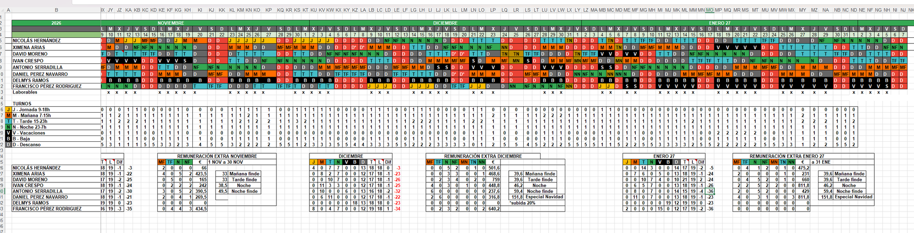

# SPEC-014 — Contador de balance jornadas trabajadas vs. días laborables (mensual y anual)

## Metadatos

| Campo | Valor |
|-------|-------|
| ID | SPEC-014 |
| Tipo | feature |
| Estado | done — validado manualmente por el DM, listo para PR |
| Prioridad | media |
| Agentes asignados | @orchestrator, @qa, @backend, @frontend |
| Fecha de creación | 2026-11-18 |
| Sprint | Sprint-07 |

---

## Descripción

En teoría, cada empleado debería tener asignada una jornada (de cualquier tipo: turno
normal, festivo, vacaciones o baja) por cada día laborable del mes — es decir, por cada
día que no sea sábado, domingo ni festivo. En la práctica esto casi nunca se cumple
exactamente, porque los descansos (D) rotan también sobre días laborables (p. ej. tras un
bloque de noches) y "consumen" un día que en teoría debería haber sido trabajado.

No es una norma de cumplimiento obligatorio, pero el DM necesita **contabilizar la
diferencia** entre jornadas trabajadas y días laborables, por empleado, tanto a nivel
mensual como acumulado en el año natural. Hoy este cálculo se lleva a mano en un Excel
paralelo a la app (ver captura de referencia).

---

## Contexto y antecedentes

- El DM ha aportado una captura de su Excel manual actual (`specs/assets/SPEC-014-excel-manual-referencia.png`),
  donde para cada mes mantiene una mini-tabla por empleado con tres columnas:
  - **T** — jornadas "trabajadas" en el mes (cualquier turno asignado que no sea D).
  - **L** — días laborables del mes (días que no son sábado/domingo/festivo; es un valor
    único, igual para todos los empleados ese mes).
  - **Dif** — `T - L`.
  Junto a cada bloque mensual hay además una columna de acumulado que suma la diferencia
  mes a mes conforme avanza el año (p. ej. la columna "a 31 ENE" del bloque de enero).
- Confirmado por el DM (2026-11-18) qué cuenta como "jornada trabajada" para esta métrica:
  **todo excepto D** — es decir, M/T/N/J, sus seis variantes de festivo/Navidad
  (MF/TF/NF/MN/TN/NN) **y también V (vacaciones) y B (baja)** cuentan como jornada
  "ocupada". Solo el Descanso (D) no cuenta. Esto es intencional: el objetivo de la
  métrica no es medir "trabajo" en sentido estricto, sino cuánto se aleja el reparto real
  de días libres del ideal teórico (un D por cada día no laborable, ningún D adicional en
  días laborables).
- Confirmado por el DM que el acumulado anual es por **año natural** (se reinicia cada 1
  de enero; el acumulado de 2026 no arrastra nada de 2025 ni de 2027).
- `VALID_SHIFT_TYPES` y la definición de festivo/fin de semana ya existen en
  `lib/schedules/business-logic.ts` y `holidayDates` (cargados en `app/page.tsx` vía
  `GET /api/holidays`), reutilizables para calcular "laborables". No existe hoy ninguna
  función que calcule días laborables de un mes ni el balance trabajado/laborable.

---

## Historia de usuario

Como **ADMIN consultando el cuadrante**,
quiero **ver, por empleado, la diferencia entre las jornadas que tiene asignadas en el mes
y los días laborables de ese mes, además del acumulado del año natural**,
para **detectar sin hacerlo a mano en Excel cuánto se desvía cada empleado del reparto
teórico de descansos, mes a mes y en el conjunto del año**.

---

## Criterios de aceptación

### Cálculo (lógica de negocio)
- [x] AC-01: Existe una función pura que calcula los días laborables de un mes dado
  (año + mes + fechas festivas), excluyendo sábados, domingos y festivos.
- [x] AC-02: Existe una función pura que calcula las "jornadas ocupadas" de un empleado en
  un mes a partir de su lista de turnos asignados: cuenta todo excepto `D` (incluye
  M/T/N/J/V/B/MF/TF/NF/MN/TN/NN).
- [x] AC-03: La diferencia mensual de un empleado es `jornadas ocupadas − días
  laborables` del mes (puede ser negativa, positiva o cero).

### Vista mensual
- [x] AC-04: En la vista del cuadrante de un mes, cada empleado muestra su diferencia
  mensual junto a los contadores de turnos ya existentes (`CountersTable`), sin necesidad
  de ninguna petición adicional al servidor (se calcula con los datos ya cargados:
  `assignments` + `holidayDates`).
- [x] AC-05: Se muestra también el número de días laborables del mes (igual para todos los
  empleados, una sola vez, no repetido por fila).
- [x] AC-06: Un valor negativo (el empleado tiene menos jornadas ocupadas que laborables)
  y uno positivo o cero se distinguen visualmente (p. ej. color), igual que ya se hace en
  otros contadores de la app.

### Acumulado anual
- [x] AC-07: Existe un endpoint (o extensión de uno existente) que, dado un año, devuelve
  por empleado la suma de diferencias mensuales de **enero hasta el último mes con
  `Schedule.published = true`** de ese año (los meses futuros/no publicados no cuentan —
  no tienen asignaciones reales y no deben penalizar el acumulado).
- [x] AC-08: La vista del cuadrante muestra, junto a la diferencia mensual, el acumulado
  del año natural en curso para cada empleado.
- [x] AC-09: El acumulado de un año no incluye nada de meses de otro año (año natural,
  confirmado por el DM).
- [x] AC-10: Si no hay ningún mes publicado aún en el año, el acumulado se muestra como 0
  (o un estado "sin datos"), no como error.

### CSV
- [x] AC-11: El CSV exportado (`buildScheduleCsv`) incluye, por empleado, las columnas
  "Laborables", "Diferencia mes" y "Diferencia acumulada año" al final de la fila, igual
  criterio de cálculo que en pantalla.

> Cada criterio de aceptación debe poder responderse con SÍ o NO.

---

## Referencias visuales

Captura del Excel manual actual del DM, que esta spec busca reproducir dentro de la app
(columnas T/L/Dif por mes + acumulado):

---

## Flujo del usuario

1. El ADMIN abre el cuadrante de un mes cualquiera.
2. En el área de resumen (donde ya están `CountersTable`, `ExtraPayTable` y
   `RatesLegend`), ve para cada empleado: sus contadores de turnos de siempre, más la
   diferencia del mes (jornadas ocupadas − laborables) y el acumulado del año natural en
   curso.
3. Si un empleado tiene, por ejemplo, 3 jornadas menos de las que le tocarían ese mes, lo
   ve como `-3` en la columna del mes; si en el año lleva acumulado `-18`, lo ve en la
   columna de acumulado.
4. Al exportar el CSV del mes, esas mismas columnas (laborables, diferencia mensual,
   diferencia acumulada) aparecen al final de cada fila.

---

## Fuera de scope

- NO incluye una vista dedicada de histórico anual detallado mes a mes (solo el acumulado
  a la fecha, no el desglose de cada mes anterior en una tabla aparte) — eso puede ser una
  spec futura si el DM lo pide.
- NO incluye alertas ni avisos automáticos cuando la diferencia supera un umbral — es un
  contador informativo, no una regla de negocio que bloquee nada.
- NO cambia la lógica de generación automática del cuadrante ni las reglas de
  festivos/fines de semana de SPEC-012 (punto 3) — esta spec es puramente de
  visualización/cálculo derivado.
- NO incluye recalcular o migrar datos históricos de años anteriores a la introducción de
  esta función — el acumulado solo aplica a partir de que exista el dato en BD.

---

## Notas técnicas para los agentes

- **Cálculo de laborables**: nueva función en `lib/schedules/business-logic.ts`, p. ej.
  `countLaborableDays(year, month, holidayDates: Set<string>): number` — itera los días
  del mes (`getMonthRange` ya existe) y excluye sábado(6)/domingo(0) y fechas presentes en
  `holidayDates`. Reutilizable desde cliente (vista mensual) y desde el futuro endpoint
  anual (necesitará los festivos de **cada** mes del año, no solo el mes visible — el
  cliente hoy solo carga `holidayDates` del año vía `GET /api/holidays?year=`, lo cual ya
  cubre los 12 meses porque `Holiday.year` es por año completo, ver
  `prisma/schema.prisma` L110-117).
- **Cálculo de jornadas ocupadas**: nueva función, p. ej.
  `countOccupiedDays(shiftTypes: string[]): number` — cuenta `shiftTypes.filter(t => t !==
  "D").length`. Puede apoyarse en `countShifts` (ya existe, L77-84) sumando todas las
  claves salvo `D`.
- **Vista mensual (AC-04/05/06)**: extender `CountersTable` en `app/page.tsx` (L37-99) con
  2 columnas nuevas ("Laborables" y "Dif. mes"), sin tocar `COUNTER_SHIFTS`. No requiere
  petición adicional — `holidayDates` y `assignments` del mes ya están en el estado de
  `HomePage`. Riesgo de regresión: bajo (solo añade columnas a una tabla existente).
- **Acumulado anual (AC-07/08/09/10)**: esto es lo único con riesgo real de diseño.
  Opciones evaluadas:
  1. Nuevo endpoint `GET /api/schedules/annual-balance?year=YYYY` que, en servidor, recorre
     los `Schedule` del año con `published = true` (modelo en `prisma/schema.prisma` L97-107),
     suma por empleado `countOccupiedDays - countLaborableDays` de cada uno de esos meses
     usando los `ScheduleAssignment` y `Holiday` ya persistidos, y devuelve el acumulado
     por empleado. **Recomendada** — es la única que da un acumulado correcto
     independientemente de qué mes esté viendo el ADMIN en ese momento.
  2. Derivarlo en cliente desde la vista `/multi-month` (que ya carga varios meses) — se
     descarta porque esa vista no necesariamente cubre de enero al mes actual, y duplicaría
     lógica de agregación en el cliente.
  Riesgo de regresión: bajo (es un endpoint nuevo, de solo lectura, no toca lógica de
  escritura existente) — pero requiere una query N+1-safe (agrupar por mes publicado del
  año, no una query por empleado).
- **CSV (AC-11)**: extender `buildScheduleCsv` en `lib/schedules/csv-export.ts` (L21-45);
  el acumulado anual requeriría pasarle el resultado ya calculado del endpoint anual como
  parámetro (la función es pura y no debe hacer fetch). Riesgo de regresión: bajo.
- Dependencias externas involucradas: ninguna.

---

## Casos de test sugeridos

- Unitario: `countLaborableDays` — mes con festivos en fin de semana (no debe restar
  doble), mes sin festivos, mes con festivo en día laborable.
- Unitario: `countOccupiedDays` — lista con D mezclado con otros tipos; lista solo de D
  (resultado 0); lista vacía.
- Unitario: diferencia mensual con datos conocidos (replicar un mes de la captura de
  Excel como caso de referencia).
- Unitario: endpoint/función de acumulado anual — año con 2 meses publicados y 10 sin
  publicar (el acumulado solo cuenta esos 2); año sin ningún mes publicado (devuelve 0, no
  error).
- E2E @smoke: la vista del cuadrante muestra la columna de diferencia mensual y el
  acumulado anual junto a `CountersTable`.
- E2E: el CSV exportado incluye las 3 columnas nuevas con valores coherentes con lo que se
  ve en pantalla.

---

## Historial de cambios

| Fecha | Autor | Cambio |
|-------|-------|--------|
| 2026-11-18 | @orchestrator | Creación de la spec a partir de una petición del DM (captura de su Excel manual de referencia). DM confirma qué turnos cuentan como "jornada ocupada" (todo excepto D) y que el acumulado es por año natural. Estado → `ready`, candidata a Sprint-07 junto a SPEC-013 (orden a decidir por @orchestrator al arrancar el sprint). |
| 2026-11-18 | @qa + @backend | AC-01/02/03 completados en rama `sprint-7-deps-y-balance-jornadas` (commit `c479765`): `countLaborableDays` y `countOccupiedDays` en `lib/schedules/business-logic.ts`, con tests TDD que cubren festivo en fin de semana (no resta doble), festivo en día laborable, y festivo local añadido a mano por el ADMIN combinado con festivo nacional. Suite unitaria completa en verde (512 passed). Pendiente: AC-04/05/06 (vista mensual), AC-07/08/09/10 (endpoint acumulado anual), AC-11 (CSV). |
| 2026-11-18 | @qa + @backend | AC-07/09/10 completados (commit `247d36b`): `GET /api/schedules/annual-balance?year=YYYY`, N+1-safe (una query de holidays y una de shiftAssignment para todo el año), sin restricción por rol porque solo agrega meses ya publicados. Tests TDD + suite completa (unit 518 passed, e2e 120 passed) sin regresiones. AC-08 (mostrarlo en la vista del cuadrante) queda pendiente para el trabajo de @frontend. |
| 2026-11-19 | @qa + @frontend | AC-04/05/06/08 completados (commit `d996ff3`): `CountersTable` en `app/page.tsx` añade el badge de laborables y las columnas "Dif. mes"/"Acum. año" con `balanceColorClass` (nueva función pura) para distinguir negativo de positivo/cero. Nuevo spec E2E `sprint-7.balance-jornadas.spec.ts` (CP-186/187). Durante el proceso se detectó y arregló una regresión de layout en CP-154 (sprint-24.spec.ts): las columnas nuevas ensanchaban `CountersTable` lo bastante para romper el `flex-wrap` que mantiene `ExtraPayTable` a la derecha. Suite completa en verde: 521 unit + 122 e2e. Solo queda AC-11 (columnas en el CSV). |
| 2026-11-19 | @qa + @backend | AC-11 completado (commit `e6c20e3`): `buildScheduleCsv` añade Laborables/Diferencia mes/Diferencia acumulada año al final de cada fila. E2E CP-188 verifica coherencia entre el CSV y lo mostrado en pantalla. Todos los AC de la spec quedan completados (521→523 unit, 122→123 e2e, ci:check limpio). Estado → `in-progress` (pendiente de validación manual del DM antes de pasar a `done`, igual criterio que SPEC-012). |
| 2026-11-19 | @frontend | Petición directa del DM durante sus pruebas manuales (no un AC original): mostrar también los días laborables junto al título del mes en la navegación, no solo en `CountersTable` (commit `46bf54b`). `laborableDays` se calcula una sola vez en `HomePage` y se pasa como prop (antes se recalculaba dentro de `CountersTable`). E2E CP-189 verifica que ambos valores coinciden. Suite completa en verde: 523 unit + 125 e2e. |
| 2026-11-19 | @frontend | Dos ajustes más del DM tras probar en servidor real: (1) rediseño a píldora redondeada a juego con el resto de badges, en vez de texto entre paréntesis (commit `d2ea43b`); (2) se quita la barra "Días laborables del mes" sobre `CountersTable` (commit `25c994a`) — quedaba redundante con la píldora y desalineaba `CountersTable` con `ExtraPayTable`. De paso, al validar manualmente se detectó y arregló que `tests/unit/models/user-role.test.ts` vaciaba `prisma/dev.db` por no estar aislado (commit `5614d69`). Validación manual del DM contra `npm run dev` con datos reales: todo correcto. Estado → `done`, lista para PR a `main`. |
